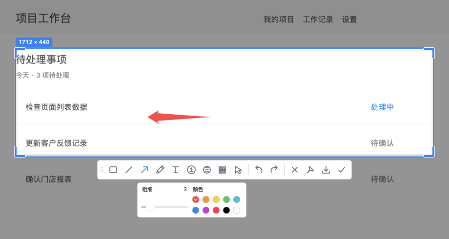
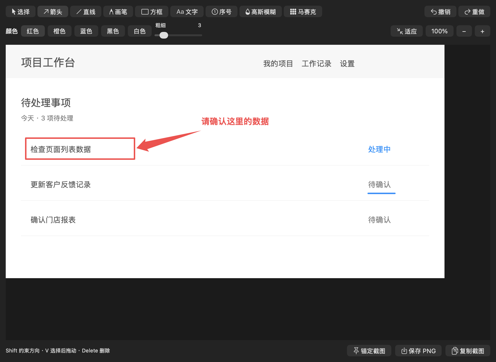

# MacMark

[简体中文](README.md) | **English**

MacMark is a lightweight screenshot, annotation, and text extraction tool for Mac. Capture a window or region, annotate it in place, then copy, save, or pin it above other windows. It is useful for explaining issues, collecting information, and keeping references visible while you work.

## Screenshots

The in-place editor provides a selection border, floating toolbar, and color controls. This preview shows the native interface with a sample image.

View the standalone image editor

## Features

| Feature | What you can do |
| --- | --- |
| Region and window capture | Highlight windows on hover, click to select or drag a region, and resize the selection using its corners |
| Annotation | Add arrows, lines, freehand strokes, rectangles, text, and numbered markers; select, move, undo, and redo |
| Blur and mosaic | Apply effects with a rectangle or brush, and adjust their strength and brush size |
| Pinned screenshots | Keep multiple images above other windows, with scaling, opacity, and a shared visibility toggle |
| Text extraction | Copy text using local OCR; copy all text from pinned images, or select text directly on compatible devices |
| Recent screenshots | Revisit the last 20 completed images to copy, save, or add further annotations |
| Local image editing | Open an existing image, annotate it, and copy it or save it as PNG |

## Download and install

**Requires macOS 14 or later.** Universal packages support Apple Silicon and Intel.

1. Download the Universal DMG from [GitHub Releases](https://github.com/black-lattice/macmark/releases/latest).
2. Drag MacMark into Applications and open it. The app lives in the menu bar.
3. Allow Screen Recording in System Settings when capturing for the first time, then quit and reopen the app.

macOS may show a security prompt for builds without Apple notarization. After verifying the source, allow the app in System Settings → Privacy & Security. See [INSTALL.txt](INSTALL.txt) for additional installation instructions (in Chinese).

## Get started

### Capture and annotate

1. Press `⌘⇧X`, or choose Region Capture (区域截图) from the menu bar.
2. Hover over a window and click to select it, or drag to select a region. Press `Esc` or right-click to cancel.
3. Add arrows, text, rectangles, and other marks using the nearby toolbar. Adjust color, stroke width, or font size as needed.
4. Copy or save the image as PNG to finish, or pin it above other windows.

Drag the selection's corners to resize it after capture. Double-click inside the selection in selection mode to copy quickly. When using text, numbers, freehand, or effect brushes, press `V` first to switch to selection mode.

### Extract text

Press `⌘⇧O` and select a region. Recognized text is copied to the clipboard. If recognition finds no text, fails, or is canceled, the previous clipboard contents are preserved.

Screenshot and text extraction shortcuts can be configured separately in the menu bar. They must use different combinations.

### Use pinned images and history

Drag an empty part of a pinned image to move it. Its context menu provides copy, save, scale, and opacity controls. On devices supporting Live Text, select text directly; alternatively, use Copy All Text (复制全部文字). The menu bar provides Hide All / Restore All Pinned Images (隐藏全部贴图 / 恢复全部贴图).

Open Recent Screenshots (最近截图) from the menu bar to copy, save, or continue annotating an image. History stores flattened images: existing marks cannot be undone individually, but new annotations can be added.

## Keyboard shortcuts

| Action | Shortcut |
| --- | --- |
| Capture / extract text | `⌘⇧X` / `⌘⇧O`, customizable |
| Arrow / line / freehand / rectangle | `A` / `L` / `P` / `R` |
| Text / numbered marker | `T` / `N` |
| Gaussian blur / mosaic | `B` / `M` |
| Select and move / delete annotation | `V` / `Delete` |
| Undo / redo | `⌘Z` / `⇧⌘Z` |
| Copy / save PNG | `⌘C` / `⌘S` |

Hold Shift to constrain a line's direction or draw a square. When editing text, Enter confirms and Shift + Enter inserts a new line.

## Privacy and usage notes

- A native macOS app. Capture, annotation, text recognition, history, and export take place locally; images are not uploaded.
- The screen is captured only when requested, without a continuous recording stream or background screen polling. Accessibility permission is not required.
- Local screenshot history is enabled by default. You can stop future recording or clear it. Canceled captures and text-only extraction do not add image history.
- Capture on individual displays is supported, but selections cannot span displays. Scrolling screenshots and video recording are not supported.
- Saving and copying preserve original image pixels. Zooming the editor's display does not reduce export resolution.

## Feedback

Report problems or suggest features through [GitHub Issues](https://github.com/black-lattice/macmark/issues).
