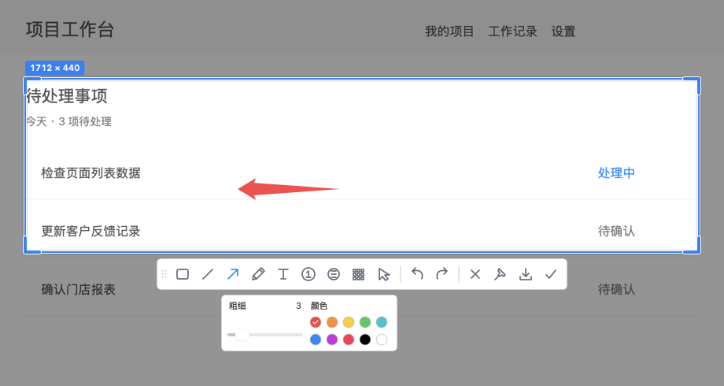
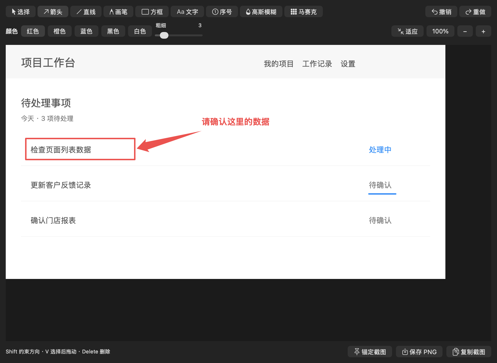

# 轻截 MacMark

**简体中文** | [English](README.en.md)

MacMark 是专用于 Mac 的轻量截图、标注与文字提取工具。通过快捷键选取窗口或区域，直接在截图原位置添加标注，再复制、保存或固定在屏幕上，适合沟通问题、整理资料和对照阅读。

## 界面预览

原位截图标注提供选区、浮动工具栏和颜色设置。下图为原生界面使用示例图片生成的预览。

查看独立图片编辑器

## 核心功能

| 功能 | 可以做什么 |
| --- | --- |
| 区域与窗口截图 | 悬停高亮窗口，点击选取或拖动框选；截图后可拖动四角调整范围 |
| 图片标注 | 箭头、直线、画笔、方框、文字、递增序号，支持选择、移动、撤销和重做 |
| 信息遮挡 | 高斯模糊或马赛克，支持框选与涂抹，调整强度和笔刷大小 |
| 锚定截图 | 将图片固定在其他窗口上方，支持多张贴图、缩放、透明度和统一显隐 |
| 文字提取 | 框选后本地 OCR 并复制；贴图支持复制全部文字，兼容设备可直接选中文字 |
| 最近截图 | 保存最近 20 张完成的图片，可重新复制、保存或继续添加标注 |
| 本地图片编辑 | 打开已有图片，添加标注并保存 PNG 或复制 |

## 下载与安装

**系统要求：macOS 14 或更新版本。** Universal 安装包同时支持 Apple Silicon 和 Intel。

1. 从 [GitHub Releases](https://github.com/black-lattice/macmark/releases/latest) 下载 Universal DMG。
2. 将 MacMark 拖入「应用程序」并打开，应用会常驻菜单栏。
3. 首次截图时，在系统设置中允许屏幕录制，授权后退出并重新打开应用。

未经过 Apple 公证的安装包可能出现安全提示。确认来源后，可在「系统设置 → 隐私与安全性」中允许打开。更多安装说明见 [INSTALL.txt](INSTALL.txt)。

## 开始使用

### 截图与标注

1. 按 `⌘⇧X`，或从菜单栏选择「区域截图」。
2. 鼠标悬停窗口后单击选取，或拖动鼠标框选区域；`Esc` 或右键取消。
3. 使用选区旁的工具栏添加箭头、文字、方框等标注，按需调整颜色、粗细与字号。
4. 点击复制或保存 PNG 完成本次截图；也可选择「锚定截图」固定在屏幕上。

截图后可拖动选区四角调整宽高。选择模式下双击选区可快速复制；文字、序号、画笔和涂抹工具下可先按 `V` 切换到选择模式。

### 提取文字

按 `⌘⇧O`，框选需要的内容，识别完成后文字会复制到剪贴板。没有识别到文字、识别失败或主动取消时，原剪贴板内容会保留。

截图和文字提取快捷键可分别在菜单栏设置，两者不能使用相同组合。

### 使用贴图与历史

锚定后拖动空白区域移动图片，通过右键菜单复制、保存、缩放或调整透明度。支持实况文本的设备可直接选中文字；也可右键「复制全部文字」。菜单栏提供「隐藏全部贴图 / 恢复全部贴图」。

从菜单栏打开「最近截图」，选择图片后可重新复制、保存或继续标注。历史保存的是合成图片，已有标注不能单独撤销；可以在此基础上添加新标注。

## 常用快捷键

| 操作 | 快捷键 |
| --- | --- |
| 截图 / 提取文字 | `⌘⇧X` / `⌘⇧O`，可自定义 |
| 箭头 / 直线 / 画笔 / 方框 | `A` / `L` / `P` / `R` |
| 文字 / 序号 | `T` / `N` |
| 高斯模糊 / 马赛克 | `B` / `M` |
| 选择与移动 / 删除标注 | `V` / `Delete` |
| 撤销 / 重做 | `⌘Z` / `⇧⌘Z` |
| 复制 / 保存 PNG | `⌘C` / `⌘S` |

绘制直线时按住 Shift 可约束方向，绘制方框时可约束为正方形。文字输入时 Enter 确认，Shift + Enter 换行。

## 隐私与使用须知

- 原生 macOS 应用；截图、标注、文字识别、历史与导出均在本地进行，不上传图片。
- 仅在主动截图时抓取屏幕，无持续录屏流或后台屏幕轮询；不需要辅助功能权限。
- 截图历史默认开启，保存在本机，可关闭后续记录或清空；取消截图及仅提取文字不会留下图片历史。
- 多显示器可分别截图，选区不能跨屏；不支持滚动截图或录屏。
- 保存与复制保留原始像素，编辑器显示缩放不降低导出分辨率。

## 反馈

遇到问题或有功能建议，欢迎提交 [Issue](https://github.com/black-lattice/macmark/issues)。
